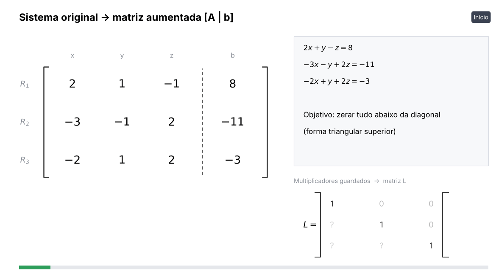

# Cálculo Numérico — Atividades

Repositório com as atividades entregues na disciplina de **Cálculo Numérico** (Profa. Raquel Jahara Lobosco), Instituto de Ciência e Tecnologia da Unifesp, São José dos Campos.

**Aluno:** Felipe Marinho de Figueiredo

## Atividades

| # | Pasta | Tema | Arquivo principal | Formato |
|---|-------|------|-------------------|---------|
| 01 | [`01-erros-numericos`](01-erros-numericos) | Erros de truncamento, arredondamento e propagação (biofluidodinâmica) | `Atividade_1.ipynb` | Notebook |
| 02 | [`02-estabilidade-overflow`](02-estabilidade-overflow) | Estabilidade de Euler explícito e overflow numérico | `Atividade_2.ipynb` | Notebook |
| 03 | [`03-zeros-de-funcoes`](03-zeros-de-funcoes) | Bisseção, Newton e secante: raízes, falhas e animações | `Atividade_3.ipynb` | Notebook |
| 04 | [`04-animacao-eliminacao-gauss`](04-animacao-eliminacao-gauss) | Animação passo a passo da eliminação de Gauss | `animacao_gauss.py` | Script + GIF |
| 05 | [`05-sistemas-lineares`](05-sistemas-lineares) | Lista de exercícios de sistemas lineares e Gauss | `Atividade_4.ipynb` | Notebook |
| 06 | [`06-interpolacao-polinomial`](06-interpolacao-polinomial) | Interpolação polinomial (Lagrange): explorar e comparar | `Atividade_Polinomio_de_Lagrange.ipynb` | Notebook |
| 07 | [`07-erros-de-interpolacao`](07-erros-de-interpolacao) | Erros de interpolação na reconstrução da temperatura de uma barra | `Tarefa_Interpolacao_resolvida.ipynb` | Notebook |
| Extra | [`08-atividade-extra-stencil-python`](08-atividade-extra-stencil-python) | Stencil (guia de consulta rápida) de comandos básicos de Python | `stencil_python.md` | Markdown |

---

## 01 — Erros numéricos em biofluidodinâmica

Estuda como a representação finita dos números e as aproximações de medidas afetam resultados físicos. Feito em dupla com Bruno de Carvalho Morais (Felipe: partes A, B e C; Bruno: partes D, E e GIF).

- **A. Truncamento e arredondamento:** aplica os dois processos a três valores com 0 a 4 casas decimais e calcula erro absoluto, relativo e percentual, com gráfico do erro em escala logarítmica.
- **B. Pressão arterial:** dez medidas em mmHg, comparando média e variabilidade da série original com três versões: arredondada para inteiro, truncada para inteiro e arredondada com 1 casa.
- **C. Vazão em tubo pequeno:** usa a lei de Hagen–Poiseuille, `Q = π r⁴ Δp / (8 μ L)`, para medir o efeito da precisão de cada variável e a sensibilidade ao raio (0,70 a 0,90 mm). Mostra que o erro do raio é amplificado quatro vezes na vazão.
- **D. Nanocateter:** repete a análise em escala de 50 nm, com erro geométrico de 0,1 a 5,0 nm, e compara `float32` com `float64` (cancelamento numérico).
- **E. Quadro de resultados:** um painel único (PNG) com os principais resultados, e um GIF do raio variando de 45 a 55 nm.

## 02 — Estabilidade e overflow

Simula a difusão de velocidade entre duas placas paralelas com Euler explícito e diferenças finitas centrais, e investiga quando o esquema deixa de ser confiável. Feito em dupla com Bruno de Carvalho Morais.

- Verifica a estabilidade pelo parâmetro `r = ν·Δt/Δy²` (estável para `r ≤ 0,5`) em dois casos: `Δt = 0,001 s` (r = 0,4) e `Δt = 0,002 s` (r = 0,8).
- Detecta overflow com `float32` e `float64` e interpreta fisicamente o crescimento explosivo da velocidade.
- Mostra que trocar o tipo numérico só adia o overflow; a causa é `r > 0,5`.
- Refina a malha para 41 pontos e mostra que isso obriga a reduzir `Δt` (limite de 0,0003125 s).
- Compara o perfil final com a solução estacionária `u(y) = U(1 − y/H)`.

## 03 — Zeros de funções

Implementa três métodos para encontrar raízes e os aplica a quatro funções (`x² − 2`, `x³ − x − 2`, `e⁻ˣ − x`, `x³ − 2x + 2`).

- **Métodos:** bisseção, Newton e secante, todos com o mesmo critério de parada (`|xₖ₊₁ − xₖ| < tol` **e** `|f(xₖ₊₁)| < tol`, com `tol = 10⁻⁶` e no máximo 100 iterações) e a mesma estrutura de retorno.
- **Tabela de resultados:** raiz, `|f(x)|` final e número de iterações por função e método.
- **Casos de falha provocados de propósito:** `f(a)f(b) > 0`, derivada ≈ 0, denominador ≈ 0 e não convergência em `max_iter`. Inclui o ciclo do Newton em `f₄` (pontos 0 e 1).
- **Animações:** GIFs da geometria de cada método (intervalo na bisseção, tangente no Newton, reta secante).
- **Análise:** a bisseção é a mais lenta (20 a 22 iterações) mas sempre converge; o Newton é o mais rápido (3 a 4) mas, em `f₄`, falhou em 3 dos 7 chutes iniciais testados; a secante ficou no meio (5 a 7) e escapou do ciclo que prende o Newton.

## 04 — Animação da eliminação de Gauss

Script que gera um GIF explicando a eliminação de Gauss e a substituição regressiva para o sistema `2x + y − z = 8`, `−3x − y + 2z = −11`, `−2x + y + 2z = −3` (solução `x = 2, y = 3, z = −1`).



- O código tem três camadas: `gerar_estados()` roda o algoritmo e guarda uma "fotografia" de cada passo, `desenhar()` transforma uma fotografia em imagem e `FuncAnimation` monta o GIF.
- Usa `Fraction` (aritmética exata), então o GIF mostra `1/2`, `3/2` etc., como na resolução à mão.
- Em cada passo destaca o pivô, o elemento a eliminar, a linha calculada e o multiplicador, e vai preenchendo a matriz `L` com os multiplicadores (ligação com a decomposição LU).
- Termina conferindo `A·x = b`.

Para gerar de novo: `python animacao_gauss.py` (cria `gauss.gif` na pasta atual).

## 05 — Sistemas lineares: lista de exercícios

Lista em quatro partes, com resolução manual em Markdown/LaTeX e código Python comentado.

1. **Conceitos e resolução manual:** escrever sistemas na forma `Ax = b` e resolver um sistema 3×3 por eliminação de Gauss.
2. **Propriedades:** classificar sistemas (solução única, infinitas soluções ou sem solução) comparando `posto(A)` e `posto([A|b])`, com uma função que faz a classificação.
3. **Implementação:** `gauss_sem_pivoteamento(A, b)`, que acusa pivô nulo, validada contra `numpy.linalg.solve`.
4. **Aplicação:** modelo de balanço térmico resolvido à mão e em Python (`T₁ = T₂ = T₃ = 5`).

## 06 — Interpolação polinomial (Lagrange)

Atividade guiada do Colab sobre como construir e avaliar o polinômio que passa por pontos dados, com as respostas do grupo preenchidas nas células indicadas.

- Diferença entre interpolar e extrapolar; relação entre número de nós e grau.
- Construção do polinômio com `numpy`, `sympy` e `scipy` (`BarycentricInterpolator`) e comparação entre as ferramentas.
- Experimento de alterar uma medição e ver o efeito no polinômio.
- Limitação do grau alto: fenômeno de Runge com `1/(1 + 25t²)` em 5, 9 e 15 nós igualmente espaçados.
- Interpolação versus regressão e síntese final.

## 07 — Erros de interpolação: temperatura em uma barra

Tarefa investigativa: reconstruir a temperatura de uma barra de 6 m a partir de sensores discretos e quantificar o erro. O perfil de referência `T(x) = 18 + 2,4·x/L + 2,5·sen(πx/L)` serve só como régua para medir o erro.

- **Métodos:** Lagrange global (forma baricêntrica), splines linear, quadrática e cúbica natural, e mínimos quadrados. Métricas: erro máximo, MAE e RMSE.
- **Etapa 1:** sete sensores exatos e igualmente espaçados.
- **Etapa 2:** número e posição dos sensores, comparando nós equiespaçados com nós de Chebyshev–Lobatto.
- **Etapa 3:** varredura de N = 4 a 40, com constante de Lebesgue, estabilidade numérica e tempo de construção e avaliação.
- **Etapa 4:** efeito do ruído de medição, erro nas extremidades, interpolação contra extrapolação e estimativa do erro sem conhecer a temperatura real (validação cruzada leave-one-out).
- **Conclusão:** recomendação técnica por situação (spline cúbica para poucos sensores; Lagrange com nós de Chebyshev para N ≥ 7 com dados exatos e perfil suave).

## Extra — Stencil de Python

Guia de consulta rápida com os comandos básicos de Python, em 12 tópicos, cada um com um exemplo curto de código: variáveis e tipos, entrada e saída, operadores, condicionais, laços (`for`, `while`, `break`, `continue`), estruturas de dados (lista, tupla, dicionário e conjunto), funções (incluindo `lambda`), strings, tratamento de erros (`try`/`except`/`finally`), módulos, compreensão de lista e classes. Os exemplos foram executados para conferir que funcionam. Atividade extra, não faz parte da sequência de Cálculo Numérico.

---

## Como executar

Os notebooks foram feitos em Python 3 e podem ser abertos no Google Colab ou localmente:

```bash
pip install -r requirements.txt
jupyter notebook
```

- Os notebooks já trazem as saídas (tabelas, gráficos e GIFs) da última execução.
- Na `Atividade_3.ipynb`, os GIFs são baixados via `google.colab` quando executada no Colab; fora dele, o notebook só avisa que os GIFs ficaram salvos na pasta de execução.
- A semente aleatória dos experimentos com ruído (atividade 07) é fixa.
